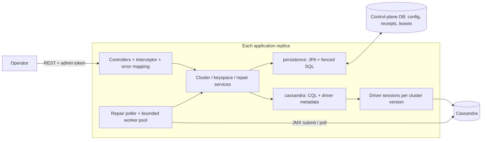
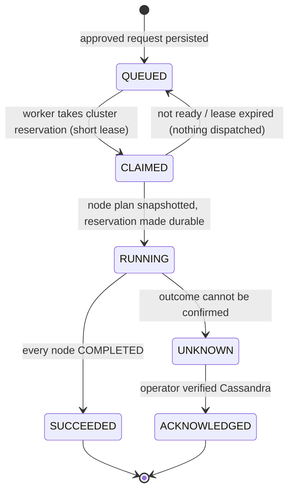

# Cassandra control-plane POC

A small DBaaS control plane for Cassandra: register clusters, provision keyspaces, and coordinate repair across
application replicas. Repair is a deliberately reduced version of what
[Cassandra Reaper](https://github.com/thelastpickle/cassandra-reaper) does: an on-demand, node-by-node primary-range
repair driven through Cassandra's asynchronous JMX API, with durable progress and explicit handling of uncertain
outcomes. Scheduling, segmentation and a UI are out of scope.

## Architecture



Packages are by domain (`cluster`, `keyspace`, `repair`) plus `common`. Inside each domain:

| Layer                                             | Responsibility                                                                           | Rule                                                                                                   |
|---------------------------------------------------|------------------------------------------------------------------------------------------|--------------------------------------------------------------------------------------------------------|
| `*Controller`                                     | HTTP mapping only                                                                        | Auth (`AdminTokenInterceptor`) and error mapping (`ApiExceptionHandler`) are cross-cutting in `common` |
| `*Service`, `RepairCoordinator`, `RepairTopology` | Use cases, admission checks, transactions                                                | Throw domain exceptions, never HTTP types; issue no SQL or CQL themselves                              |
| `<domain>.persistence`                            | Control-plane DB: JPA entities, derived queries, fenced SQL for repair transitions       | Entities stay behind the services; other layers see records                                            |
| `<domain>.cassandra`                              | Data plane: `CassandraSessions`, `ClusterMetadataRepository`, `KeyspaceSchemaRepository` | All CQL and driver metadata access lives here                                                          |
| `repair.jmx`                                      | JMX client and endpoint configuration                                                    | Remote calls never run inside a database transaction                                                   |

Dependencies point one way: `keyspace` and `repair` depend on `cluster`, never the reverse. The cluster domain
asks "is there pending work?" through the `PendingClusterWork` interface, which they implement.

**The control-plane database is the only shared state.** It holds configuration, provisioning ownership, repair
receipts and every lease, compared against database time (`DatabaseClock`). It is PostgreSQL for multiple replicas
and H2 for the single-process local demo. Driver sessions and thread pools are local and rebuilt on demand. Schema is
one
Flyway migration (`V1__create_control_plane.sql`).

**Persistence style.** Reads use Spring Data derived queries. Records such as `ClusterRecord.Summary` and
`OperationRecord` are DTO projections, so polling never loads entity collections. The only hand-written SQL is in
`RepairExecutionRepository` and the three keyspace lease updates. There, `FOR UPDATE SKIP LOCKED` and
compare-and-set row counts *are* the correctness mechanism.

## Workflows

| Workflow                                                     | Behavior                                                                                                                                                                                                                                                                                                                          |
|--------------------------------------------------------------|-----------------------------------------------------------------------------------------------------------------------------------------------------------------------------------------------------------------------------------------------------------------------------------------------------------------------------------|
| Cluster registration (`PUT /clusters/{id}`)                  | Stores connection settings under the cluster row lock. A change is rejected while repair or provisioning work is pending; an identical replay is a no-op. Each request carries the config version it read, so every replica lazily builds a session for a new version and gracefully closes the old one.                          |
| Keyspace provisioning (`POST /clusters/{id}/keyspaces/{ks}`) | Synchronous. Takes a lease on `(cluster, keyspace)` under the cluster row lock (quota-safe), runs idempotent DDL with heartbeats, then validates replication and the probe table before marking READY.                                                                                                                            |
| Probe (`POST .../probe`)                                     | Real `LOCAL_QUORUM` write and read-back: the availability proof. `GET /clusters/{id}/health` is driver-observed only.                                                                                                                                                                                                             |
| Repair (`POST /clusters/{id}/repair`)                        | Validates topology and schema, persists a receipt and returns `202` immediately. The plan is the cluster's configured JMX targets (`demo.repair.jmx.targets.<cluster>.<node>`) in node-name order; it is snapshotted when the run starts. Workers submit and poll one node at a time (`repairAsync`, incremental, primary range). |

## Repair state machine



Per node (`GET /operations/{id}/nodes`): `PENDING → SUBMITTING → RUNNING → SUCCEEDED`, or `UNKNOWN`.
`SUBMITTING` is written *before* the non-idempotent JMX call. If a worker dies after that point, the next worker
marks the node `UNKNOWN` and never resubmits.

| Becomes UNKNOWN (reservation retained)                          | Retried safely (nothing dispatched)                                          |
|-----------------------------------------------------------------|------------------------------------------------------------------------------|
| Submit threw or timed out after intent was recorded             | JMX unreachable before submission                                            |
| Worker vanished while `SUBMITTING`                              | Topology not ready (node down, host-ID mismatch) or schema agreement pending |
| Cassandra restarted (JVM start time changed) or host ID differs | Status poll failed or status MISSING (re-polled)                             |
| Cassandra reported `FAILED` or an unrecognized status           | Claim lease expired before the plan was persisted                            |
| Node exceeded the observation deadline                          |                                                                              |

**Slow repairs.** Each node's clock starts at *its own* submission, so a long serial plan never times out a node
that just started. After `delayed-after-seconds` (default 24h) the node and its operation get `delayed=true` and
polling continues. After `observation-deadline-seconds` (default 7 days) the node becomes `UNKNOWN`. A `PENDING` node
has no clock: it waits, without dispatching, until the cluster is healthy again.

## Concurrency and idempotency

- **One repair per cluster.** The single `repair_locks` row per cluster (created at first admission) is the
  reservation: a short lease while
  `CLAIMED`, and durable (no expiry) once a node plan exists, until `SUCCEEDED` or acknowledgement. Independent
  clusters repair in parallel.
- **Work distribution.** Any replica claims runs and node actions with `FOR UPDATE SKIP LOCKED`. Each node action
  carries its own short lease (`action-lease-seconds`); every write is fenced by owner, and a lost fence stops the
  stale worker.
- **Admission is serialized per cluster** by the cluster row lock, and re-checks the configuration version it
  validated, so a concurrent config change cannot slip in between.
- **Idempotency.** Repair: `Idempotency-Key` header, unique per cluster; a replay returns the original receipt,
  even if the cluster is now unhealthy. Provisioning: `(cluster, keyspace)` is the identity; retries converge.
  Acknowledgement and identical configuration saves are no-ops on replay.
- **Backpressure.** At most 1,000 queued repairs per cluster; persisted exponential backoff (5s → 300s) for runs
  that cannot start; bounded worker and connection pools.

## Guarantees

- At most one active or uncertain repair per registered cluster, across all replicas.
- No automatic resubmission of a node repair whose submission outcome is unknown.
- Repair starts only when every configured node is UP, host IDs match the JMX plan, and the keyspace schema matches.
- A crashed worker never strands work: undispatched claims are requeued, and in-flight polls are taken over.
- Not guaranteed: exactly-once remote execution. `UNKNOWN` means "verify Cassandra, then
  `POST /operations/{id}/acknowledge` with `{"cassandraActivityVerified":true}`". Acknowledgement releases the
  cluster; it does not claim the repair succeeded.

## Worker placement and scale

The worker is a scheduler and status checker, not a data mover. Cassandra performs the comparison and streaming.
One poller thread per replica claims due work every second; a bounded pool (`worker-threads`, default 8) runs each
unit: one JMX round trip of seconds, bounded by RMI timeouts. Threads are released between polls, so 8 threads
can follow far more than 8 concurrent node repairs.

- **Thread or instance?** A thread pool inside the API process is enough, which is also how Reaper runs. Because
  coordination is in the database, setting `DBAAS_REPAIR_WORKER_ENABLED=false` on API replicas turns any replica
  into a dedicated worker tier without code changes. Do that when repair needs independent scaling or isolation.
- **Hundreds of nodes.** Each actively repairing node costs one claim query plus one JMX call per poll
  interval (20s). Even 300 nodes polled at once would be about 15 short actions per second, well inside one pool;
  in practice only one node per cluster is active. Within a cluster, nodes are repaired serially by design (Reaper
  likewise never runs two repairs on one node), so wall time is the sum of node repair times. The real fleet-scale
  limit is elsewhere: every replica that serves a cluster holds a driver session to it (the driver is the
  connection pool). Assigning clusters to replicas is the next step, and is out of scope here.

## Run locally

Requirements: Java 21, Maven, Docker Desktop (Linux containers, ~8 GiB) and PowerShell.

```powershell
docker compose up -d --wait --wait-timeout 900   # 3-node Cassandra 5.0.5, RF 3
mvn -B package                                   # also runs the unit and H2 persistence tests
.\run-local.cmd                                  # discovers JMX host IDs, starts http://localhost:8088
```

Local mode uses H2 in `.local/`; delete `.local/control-plane-keyspaces.*` after schema changes. The admin token
is `local-demo-only`; local JMX is unauthenticated and bound to loopback. The `.cmd` launchers contain
their PowerShell and start it with a process-scoped execution-policy bypass, so no machine policy change is needed.

```powershell
$base = 'http://localhost:8088'; $admin = @{'X-Admin-Token' = 'local-demo-only'}
Invoke-RestMethod "$base/clusters/default/health"
Invoke-RestMethod "$base/clusters/default/keyspaces/interview" -Method Post -Headers $admin
Invoke-RestMethod "$base/clusters/default/keyspaces/interview/probe" -Method Post -Headers $admin `
    -ContentType application/json -Body '{"value":"hello"}'
$admin['Idempotency-Key'] = [guid]::NewGuid().ToString()
$op = Invoke-RestMethod "$base/clusters/default/repair" -Method Post -Headers $admin `
    -ContentType application/json -Body '{"keyspace":"interview","approved":true}'
Invoke-RestMethod "$base/operations/$($op.id)" -Headers $admin
Invoke-RestMethod "$base/operations/$($op.id)/nodes" -Headers $admin
```

## Verify

| Command                  | What it proves                                                                                                                                                                                                |
|--------------------------|---------------------------------------------------------------------------------------------------------------------------------------------------------------------------------------------------------------|
| `.\verify.cmd`           | Also the integration tests: live JMX repair of all three nodes with worker handoff, concurrent provisioning, and PostgreSQL `SKIP LOCKED` coordination between two replicas. It does not touch a running app. |
| `.\verify.cmd -Recovery` | Against the running app: stops one node, shows `LOCAL_QUORUM` still served, restarts it, then repairs.                                                                                                        |

## Out of scope

Production authentication and authorization; repair scheduling, segmentation and intensity; multi-datacenter
clusters; topology changes; backup and restore; coordination with repairs started outside this service; durable
provisioning failure history; assigning clusters to replicas; changing repair targets without a redeploy.
On replicas other than the one that disabled a cluster, its idle session is closed at restart. JMX endpoints and
credentials are deployment
configuration and must match across replicas. A divergent replica fails closed, because the persisted plan
pins each node's endpoint and host ID.
