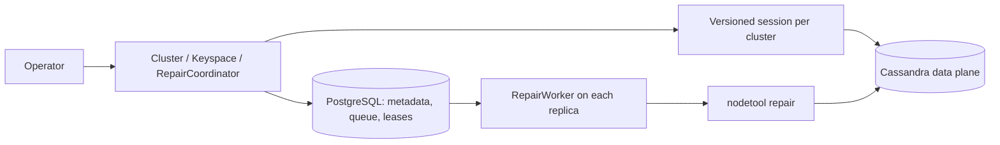

# Cassandra control-plane POC

A three-day DBaaS prototype: cluster metadata, keyspace creation, and safe coordination of Cassandra repair.
**The main feature is operational guardrails around `nodetool repair`, not infrastructure management.**

## What it does

- Registers Cassandra clusters and their connection settings, replication expectations, and repair policies.
- Creates/revalidates keyspaces and a small probe table; checks real `LOCAL_QUORUM` writes and reads.
- Queues approved repair requests durably, executes them, and exposes operation status.
- Supports multiple application replicas sharing PostgreSQL; independent clusters can repair concurrently.

It does not create machines, stop/start Cassandra nodes, manage backups, or provide tenant isolation.
A returning node is observed by the driver; repair requires an explicit request.

## Run the demo

Requirements: Java 21+, Maven, PowerShell 7, Docker Desktop with Linux containers, and about 8 GiB available to Docker.
Run from this repository directory. Ports 8088 and 9042–9044 must be available.

```powershell
docker compose up -d --wait --wait-timeout 900
docker compose exec -T cassandra1 nodetool status
$env:SPRING_PROFILES_ACTIVE = 'local'
./run-local.ps1
```

`run-local.ps1` builds/tests the application and starts it on `127.0.0.1:8088`.
Wait for three `UN` nodes and `/clusters/default/health` to report `HEALTHY` before the demo.
Defaults: datacenter `dc1`, replication factor 3, five managed keyspaces, and admin token `local-demo-only`.
Local H2 persists metadata under `.local/control-plane-keyspaces` and supports **one application process**.
Use a fresh control-plane database for this schema; upgrading older POC schemas is not supported.

In another terminal, create a keyspace and prove a quorum read/write:

```powershell
$base = 'http://localhost:8088'
$admin = @{'X-Admin-Token'='local-demo-only'}
Invoke-RestMethod "$base/clusters/default/health"
Invoke-RestMethod "$base/clusters/default/keyspaces/interview" -Method Post -Headers $admin
Invoke-RestMethod "$base/clusters/default/keyspaces/interview/probe" `
  -Method Post -Headers $admin -ContentType application/json -Body '{"value":"hello"}'
```

Submit a repair and observe its durable status:

```powershell
$admin['Idempotency-Key'] = [guid]::NewGuid().ToString()
$body = '{"keyspace":"interview","approved":true}'
$op = Invoke-RestMethod "$base/clusters/default/repair" `
  -Method Post -Headers $admin -ContentType application/json -Body $body
do {
  Start-Sleep -Seconds 2
  $status = Invoke-RestMethod "$base/operations/$($op.id)" -Headers $admin
  $status | Select-Object id,state,detail
} while ($status.state -in @('QUEUED','CLAIMED','RUNNING'))
```

Replaying the same request/key returns the same operation; different content with that key is rejected.
The worker runs `docker compose exec -T {node} nodetool repair -pr interview` on each configured node.
Inspect `.local/operations/` for command logs. The expected successful terminal state is `SUCCEEDED`.

## The guardrails

| Concern | Enforced behavior |
|---|---|
| Duplicate submission | A cluster-scoped idempotency key identifies one durable request. |
| Concurrent repairs | One active repair per registered cluster; independent clusters can run in parallel. |
| Competing replicas | Transactional claims with `FOR UPDATE SKIP LOCKED`; shared PostgreSQL owns coordination. |
| Stale workers | Owner and unexpired lease checks fence dispatch decisions and SQL completion; leases use database time. |
| Unsafe admission | Explicit approval, valid identifiers, enabled cluster, expected nodes UP, and compatible schema. |
| Configuration changes | Changes are blocked while repair work is pending or a provisioning lease is active. |
| Overload/outage | Bounded worker/connection pools, queue cap of 1,000 per cluster, and persisted retry backoff. |
| Partial completion | Completion and lease release commit together; uncertain remote work retains exclusion. |

**SQL fencing cannot stop a command already running in Cassandra. There is no exactly-once remote execution guarantee.**
Each physical Cassandra cluster must have one registry identity; aliases would bypass per-cluster exclusion.
The admin token is a local-demo access gate, not production identity management.

## High-level design



- **Separate control and data planes:** SQL is the coordination authority; Cassandra stores application data.
- **Keep transactions short:** commit admission/ownership before remote calls. No distributed transaction spans SQL and Cassandra.
- **Scale by independent work:** stateless APIs and shared durable state; cluster locks serialize only that cluster's repairs.
- **Use one authority:** no broker or distributed cache is needed for this POC. Ownership decisions always come from SQL.
- **Contain dependency failures:** a disconnected cluster does not block other clusters; delayed work backs off rather than occupying workers.

Repair lifecycle: `QUEUED → CLAIMED → RUNNING → SUCCEEDED`.
`RUNNING` is persisted **before** invoking a remote command, so a crash can leave its outcome uncertain.

| Failure point | Recovery |
|---|---|
| Before dispatch | Safe retry with persisted backoff; expired CLAIMED work returns to QUEUED. |
| After possible dispatch | Record UNKNOWN; expired RUNNING work also becomes UNKNOWN. No automatic replay. |
| Operator reconciliation | Stop/fence the old worker and inspect remote repair activity, then acknowledge to release exclusion. |
| Keyspace creation interrupted | Release/expire ownership; caller retries idempotent DDL and schema validation. |

Acknowledgement uses `POST /operations/{id}/acknowledge` with `{"cassandraActivityVerified":true}`.
It records `ACKNOWLEDGED`; it neither cancels remote work nor proves the repair succeeded.
Provisioning is synchronous: failed attempts remain PROVISIONING, retain quota, and have no persisted error history.

## Show the architecture working

With the local application running:

```powershell
./verify-recovery.ps1
```

This script stops one node, proves quorum writes/reads, starts the node, verifies recovery, and explicitly requests repair.
**The script restarts the node; the Java application does not.** All four phases perform 20 write/read checks.

For a two-replica demonstration, use a disposable PostgreSQL database:

```powershell
docker run -d --name dbaas-poc-postgres --memory 512m -p 127.0.0.1:15433:5432 `
  -e POSTGRES_PASSWORD=queue-demo-only postgres:17.6
docker exec dbaas-poc-postgres pg_isready -U postgres
# Wait until pg_isready reports accepting connections.
./two-instance-smoke.ps1 -JarPath "$PWD/target/dbaas-demo-1.0.0.jar" -ProjectDirectory "$PWD"
./verify-system.ps1 -Recovery
```

The smoke script launches/stops two JVMs, checks cross-replica idempotency, and runs a real repair.
`verify-system.ps1` launches/stops another test server and checks authentication, validation, configuration replay,
provisioning, quota, disabled/unavailable clusters, session isolation, and node recovery.

Automated tests, including PostgreSQL worker contention and recovery:

```powershell
docker exec dbaas-poc-postgres createdb -U postgres queue_test
$env:DBAAS_QUEUE_TEST_JDBC_URL = 'jdbc:postgresql://localhost:15433/queue_test'
mvn clean verify
Remove-Item Env:DBAAS_QUEUE_TEST_JDBC_URL
docker stop dbaas-poc-postgres
```

Verified locally: **40 tests passed, none skipped**, two application replicas completed a real repair,
and 80 quorum write/read checks passed through healthy, down-node, recovery, and post-repair phases.
An initial provisioning request returned 503 during schema convergence; an explicit retry completed successfully.

## POC boundaries and next decisions

This is a coordination demonstration, not a production DBaaS. It has no node lifecycle management, automatic repair
on node recovery, backup/restore, or production authentication. Driver health and probes are not a full data-integrity audit.
Next priorities: observable provisioning failures/reconciliation, operation retention/metrics, and production access control.
Fleet scale needs measurement and session assignment/sharding: every replica currently connects to every enabled cluster.
Load/soak testing, disk-loss recovery, and killing a worker during real remote repair were not exercised.
Stop the local application with Ctrl+C; `docker compose down` stops Cassandra while preserving its data volumes.
