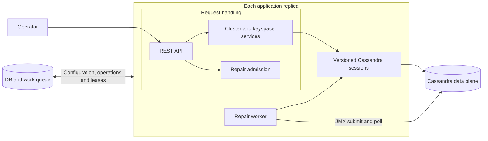
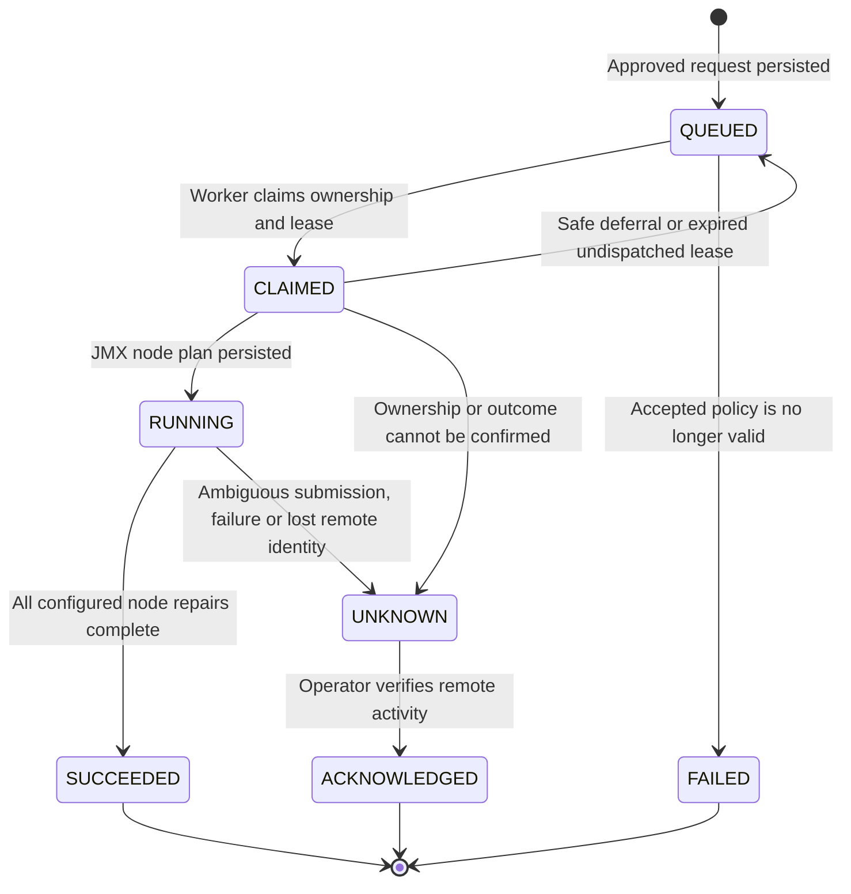

# Cassandra control-plane POC

A DBaaS control-plane prototype for registering Cassandra clusters, provisioning keyspaces and coordinating repair
across application replicas. Repair uses Cassandra's asynchronous JMX management API, with persisted
node progress and explicit handling of uncertain remote outcomes.

## Architecture



PostgreSQL is the authority for configuration, provisioning ownership, repair receipts and leases. Cassandra stores
application data. API replicas share durable state; local sessions and worker pools can be rebuilt after restart.
The local demo uses H2 for one application process; multiple replicas require shared PostgreSQL.

| Workflow              | Behavior                                                                                                                                           |
|-----------------------|----------------------------------------------------------------------------------------------------------------------------------------------------|
| Cluster registration  | Stores connection settings and versioned repair policies; reconnects sessions when configuration changes.                                          |
| Keyspace provisioning | Synchronously creates or revalidates the keyspace and probe table. `(clusterId, keyspace)` is its identity; retries converge on the same resource. |
| Repair                | Persists an approved request and node plan; workers submit and poll one node at a time through JMX, releasing their slot between observations. |
| Health and probing    | Reports driver-observed availability; a `LOCAL_QUORUM` write/read probe demonstrates actual request availability.                                  |

Services coordinate configuration, provisioning admission and repair workflows within short database transactions.
Cross-domain coordination stays in services; repositories focus on their own persistence. JPA handles ordinary
persistence. Explicit SQL handles repair claims and ownership transitions where row locks and affected-row checks
are part of correctness. Remote Cassandra calls run outside database transactions.

Cluster inventory is lightweight: `GET /clusters` returns scalar summaries without loading connection collections or
repair policies. `GET /clusters/{id}` returns the full configuration and repair policy; both require the admin token.
The connector polls only cluster IDs, enablement and versions, loading connection settings when a session is needed.

### Concurrency and recovery

- **Deduplication:** a cluster-scoped idempotency key identifies one repair request. Replaying it returns the original
  receipt.
- **Exclusion:** one active or uncertain repair per registered cluster; independent clusters can run concurrently.
- **Coordination:** replicas claim work with `FOR UPDATE SKIP LOCKED`. Database-time leases and owner checks protect
  state transitions.
- **Admission:** approval, identifiers, topology and schema are checked. Configuration changes are blocked while repair
  work or an active provisioning lease is pending.
- **Backpressure:** bounded worker/connection pools, a cap of 1,000 queued repairs per cluster and persisted retry
  backoff contain outages.
- **Worker placement:** ideally, deploy repair workers as independent, autoscaled instances sharing the durable queue,
  so maintenance capacity can scale separately from API traffic. API instances can set
  `DBAAS_REPAIR_WORKER_ENABLED=false`;
  worker instances keep execution enabled. Per-cluster exclusion still applies regardless of worker count.

### Repair state machine



| State        | Meaning and next action                                                                                                   |
|--------------|---------------------------------------------------------------------------------------------------------------------------|
| QUEUED       | Durable request waiting for a worker.                                                                                     |
| CLAIMED      | A worker owns the lease; remote dispatch has not been recorded. Safe undispatched work can be requeued.                   |
| RUNNING      | Durable JMX node plan is active. Cluster reservation persists; workers hold short claims only while submitting/polling. |
| SUCCEEDED    | All configured repair commands completed successfully; cluster exclusion is released.                                     |
| FAILED       | A confirmed rejection/failure, such as an invalid queued policy; no uncertain remote work is automatically retried.       |
| UNKNOWN      | The remote outcome is uncertain. Cluster exclusion remains, even after lease expiry; operator reconciliation is required. |
| ACKNOWLEDGED | The operator verified remote activity and released exclusion; this does not assert repair success.                        |

A JMX submission with an uncertain response becomes UNKNOWN, not FAILED. Missing status or transient
observation errors are polled again until the observation deadline; an unsupported status or changed JVM
identity becomes UNKNOWN immediately. Acknowledgement uses
`POST /operations/{id}/acknowledge` with `{"cassandraActivityVerified":true}` after the old worker is stopped/fenced and
remote activity has been inspected. Any subsequent repair is a new request with a new idempotency key.

Provisioning is a separate synchronous workflow: ownership is released or expires after interruption, and a caller
retry repeats safe DDL and validates the resulting schema.
SQL ownership cannot stop a command already running in Cassandra or atomically fence its dispatch.
**There is no exactly-once remote execution guarantee.** Completion and lease release commit together; uncertainty
requires reconciliation. Acknowledgement releases exclusion, but does not prove repair succeeded.
Each physical Cassandra cluster must have one registry identity to preserve exclusion.

## Run locally

Requirements: Java 21+, Maven, Docker Desktop with Linux containers and PowerShell. A 16 GB laptop with about 8 GiB
available to Docker is a practical local setup. Run commands from this repository directory.

```powershell
docker compose up -d --wait --wait-timeout 900
$env:SPRING_PROFILES_ACTIVE = 'local'
./run-local.ps1
```

The application starts at `http://localhost:8088`. Wait until cluster health reports `HEALTHY`.
The local cluster has three nodes with replication factor 3. Connection polling defaults to 20 seconds;
set `DBAAS_POLL_INTERVAL_SECONDS` before starting the application to change it.

**Repair prerequisite:** `DBAAS_REPAIR_TRANSPORT` defaults to `jmx`, but the standard `compose.yml`
does not expose remote JMX or provide node host-ID mappings. The commands above support registration,
provisioning and probes; the repair request below requires reachable JMX endpoints configured under
`demo.repair.jmx.targets.default` for all three nodes. See
[JMX endpoint configuration](JMX-REPAIR-REVIEW.md#required-deployment-configuration).
Without those mappings, repair is rejected at admission. To verify native JMX repair independently
using an isolated, automatically configured two-node fixture, run `./verify-jmx.ps1`.
JMX workers check for due work every second; remote status observations default to 20 seconds
(`demo.repair.jmx.poll-seconds`).

In another terminal, run this end-to-end example:

```powershell
$base = 'http://localhost:8088'
$admin = @{'X-Admin-Token' = 'local-demo-only'}
$pollSeconds = 20
if ($env:DBAAS_POLL_INTERVAL_SECONDS) { $pollSeconds = [int]$env:DBAAS_POLL_INTERVAL_SECONDS }

Invoke-RestMethod "$base/clusters" -Headers $admin
Invoke-RestMethod "$base/clusters/default" -Headers $admin

Invoke-RestMethod "$base/clusters/default/health"
Invoke-RestMethod "$base/clusters/default/keyspaces/interview" -Method Post -Headers $admin
Invoke-RestMethod "$base/clusters/default/keyspaces/interview/probe" `
    -Method Post -Headers $admin -ContentType application/json -Body '{"value":"hello"}'

$admin['Idempotency-Key'] = [guid]::NewGuid().ToString()
$body = '{"keyspace":"interview","approved":true}'
$op = Invoke-RestMethod "$base/clusters/default/repair" `
    -Method Post -Headers $admin -ContentType application/json -Body $body
do {
    Start-Sleep -Seconds $pollSeconds
    $status = Invoke-RestMethod "$base/operations/$($op.id)" -Headers $admin
    $status | Select-Object id,state,detail
} while ($status.state -in @('QUEUED','CLAIMED','RUNNING'))
```

With the JMX prerequisites configured, the expected repair result is `SUCCEEDED All JMX node repairs completed`.
Inspect `GET /operations/{id}/nodes` with the admin header for per-node progress. Use your configured admin token if it
differs. To retry a lost repair response, resend the request with the same idempotency key; create a new key only for a
new repair.

Stop the application with Ctrl+C. `docker compose down` stops Cassandra and preserves its data volumes.

## Verify the design

```powershell
# Unit/persistence tests only; this excludes *IT integration tests:
mvn -o -B '-Dmaven.repo.local=.m2' test
# Unit tests plus live Cassandra 5.0.5 and PostgreSQL upgrade tests; starts/stops its fixture:
./verify-jmx.ps1
```

The script enables Failsafe with `-Pintegration`, explicitly selects `JmxCassandraIT` and
`RepairPolicyMigrationIT`, and enables the live test with `-Djmx.live=true`. It fails if either
integration test is absent or skipped. Failsafe reports are under `target/failsafe-reports`;
reviewable result counts and real server observations are retained under `verification/jmx`.
The offline commands assume `.m2` is populated; omit `-o` on a first build if dependencies are missing.

For a live three-node recovery demonstration, first configure the main application's three JMX
endpoints as described above, keep the local application running, and use:

```powershell
./verify-recovery.ps1
```

The script stops one node, proves quorum reads/writes, restarts it, requests repair and checks reads/writes again.
Its status interval defaults to 20 seconds and can be set with `-PollIntervalSeconds` or `DBAAS_POLL_INTERVAL_SECONDS`.
**The script restores the node; the application observes recovery and coordinates the requested repair.**

## Scope and next steps

This POC manages coordination, not infrastructure: no machine provisioning, node lifecycle management, backup/restore
or automatic repair on node recovery. The demo token is not production authentication. The control-plane schema
expects a fresh database; upgrades from older POC schemas are not supported.

Provisioning recovery requires a caller retry and has no durable failure history. Next priorities are failure
visibility,
reconciliation, operation retention/metrics and production access control.

Horizontal scaling increases capacity across independent clusters, but every replica currently connects to every
enabled cluster. Larger deployments may require assigning clusters to specific replicas to limit connection and memory
costs.
Splitting API and worker tiers (`DBAAS_REPAIR_WORKER_ENABLED`) raises repair throughput without slowing request
handling,
but each worker still connects to every enabled cluster, so session assignment remains the prerequisite for fleet scale.

The local tests verify functional correctness and coordination. Fleet-scale performance should be evaluated separately
in a representative environment, measuring throughput, latency and resource usage under both peak and sustained
workloads.
Disk-loss recovery and worker crashes during remote repair require separate failure-injection tests.
